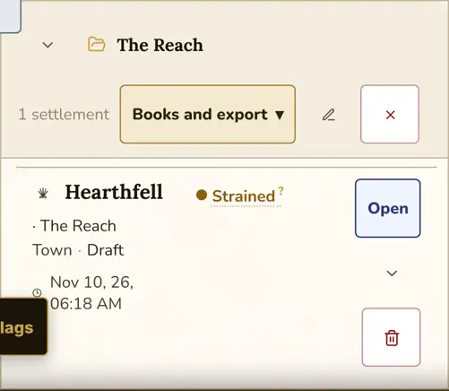
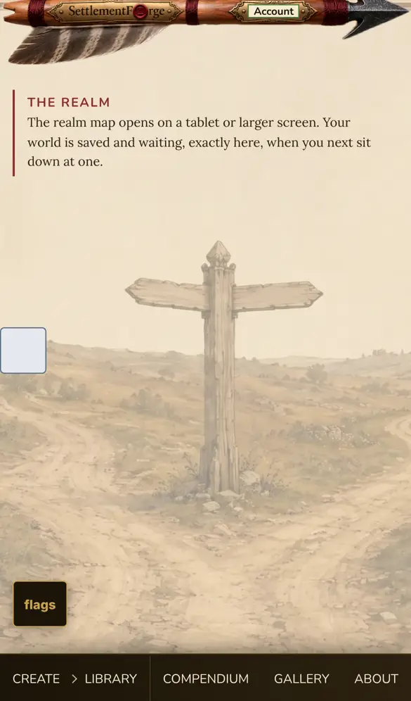
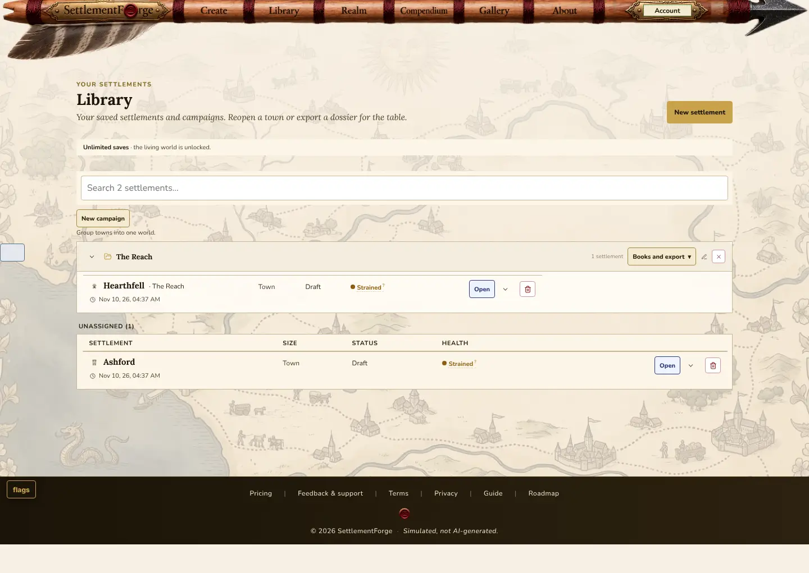
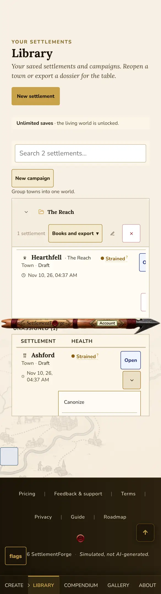
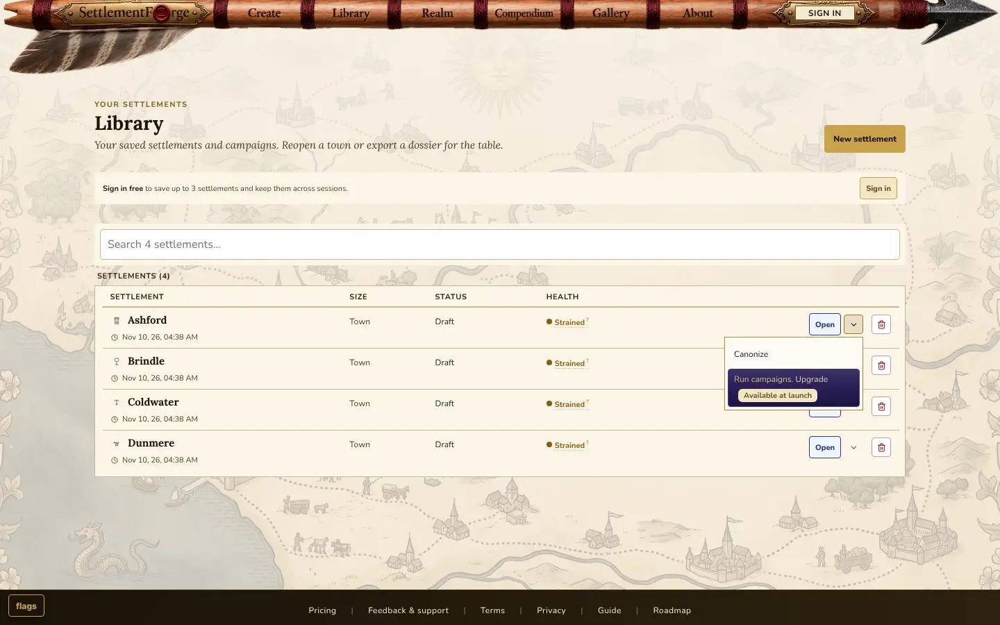

# LIBRARY-SIMPLE — the Library advances nothing, 2026-11-10

Seat LIBRARY-SIMPLE, a child of the chair session `session_01FbPLbejcfwX5nii12VM673`. Lane
`lane/library-simple-2026-11-10`, cut from `lane/integration-2026-11-07` at **bf14617ca** (its tip,
confirmed by `git rev-parse`). The lane lands after the release.

**The owner's words (2026-11-10 ~04:0x UTC, verbatim):** "I now want to simplify the library page. No
longer does it advance time. That will only be accessible in isolated (not in campaign settlements) or
the realm page. The library should only house settlements, allow to view them edit settlements where
gated, create campaigns, and then assign campaigns to settlements. Etc etc. anything associated that is
an independent campaign advance time outside of the realm needs to be removed."

## The census (Phase 0, sent before any edit, accepted whole by the chair)

The Realm's own advance, the reference: `WorldMapToolbar.jsx:454-479` ("Advance by" Week/Month/Season/
Year select and the gold "Advance Realm"; `useAdvanceSession.js:154` → `advanceCampaignWorld`), the
auto-resolve switch in its advance confirm (`WorldMap.jsx:897-898`), and the world-canonize CTA in that
dialog (`WorldMap.jsx:900-901`). Drawn only while a campaign is active. At phone width the Realm route
renders `RealmPhoneNotice` instead (`AppViews.jsx:177`, ODQ §934.26).

| # | Library item (at the base) | advances | mounted | tier | Realm offers it? | now |
|---|---|---|---|---|---|---|
| 1 | Folder "Advance by" interval select (`CampaignFolder.jsx:170, 308-330`) | the campaign world | folder header | premium/elevated | yes, `WorldMapToolbar.jsx:455` | removed |
| 2 | Folder "Advance Time" button, its title strings and handler (`:171-183, 335-344`) | the campaign world | folder header | premium | yes, `WorldMapToolbar.jsx:472-479` | removed |
| 3 | Folder auto-resolve switch (`:119-126, 133-134, 276-302`, flag `advanceMultiTick`) | sets the shared `advanceAutoResolve` | folder header | premium + flag | yes, `WorldMap.jsx:897-898` | removed |
| 4 | Folder advance gating: `isAdvanceInFlight`, `isCampaignMutationLocked`, the `worldCanonized` prop | preparation | folder | — | n/a | removed (dead) |
| 5 | "Between Your Towns" +1/+3 (`RegionalGraphSummary.jsx:138-155`) ← folder `onAdvanceRegionalImpacts` ← panel `handleAdvanceRegionalImpacts` | the campaign's regional graph and news tick only (`campaignRegionalSlice.js:432`) | folder body | premium | not as a standalone act; the Realm's advance matures impacts every tick (`applyWorldPulse.js:273, 343`) | removed (STOP-1) |
| 6 | Card menu "Advance Time" (`SettlementCard.jsx:566-578`) → `onAdvanceTime(campaignId)` | the campaign world | card menu | premium | yes (as #2) | removed |
| 7 | Card free-tier row "Advance time and run campaigns. Upgrade" → /pricing (`:551-563`) | nothing (a sales row) | card menu | free/anon | n/a | "Run campaigns. Upgrade" (STOP-3) |
| 8 | The `onAdvanceTime` prop through `SettlementCard`, `UnassignedLedger`, `CampaignFolder`, `SettlementsPanel` | plumbing | — | — | n/a | removed |
| 9 | `useCampaignAdvance.js` (the handler and `ADVANCE_REFUSAL_TEXT`), the panel's `advanceCampaignWorld` / `setActiveCampaign` reads, the "Advance:" alert | the campaign world | panel | premium | yes (`useAdvanceSession` / `useRealmInspector`) | removed |
| 10 | `advanceTimeTarget.js` (`ADVANCE_TIME_NAV_TARGET`), read only by #9 | nav after an advance | — | — | n/a | removed |
| 11 | Header subtitle "…Reopen a town, advance its world, or export a dossier…" (`SettlementsPanel.jsx:774`) | a promise | header | all | — | clause cut |
| 12 | Helper "Group towns into one world that advances together." (`:829`) | a promise | new campaign | premium | — | clause cut |
| 13 | RealmStrip "N settlement(s) will change on the next Advance" (`RealmStrip.jsx:191-193`) | presents Realm state, no control | folder body | premium + canonized | — | kept (STOP-4) |
| 14 | `SettlementCard.jsx:100` reads `advanceInFlight` to block add/remove/delete while an advance runs | a guard, not an advance | card | — | — | kept |

**What the Library keeps (L4), all present and untouched:** listing and housing (the ledger, the
folders, search/sort/filter, the bulk bar); opening and viewing (`SettlementDetail`, the route sync);
editing where the tier allows (the card's Edit → `EditModeShell`); renaming; deleting (single and bulk,
and "Record its destruction"); exporting (the folder's "Books and export" and the bulk export);
reactivating; forking a sample; creating, renaming, deleting and collapsing campaigns; adding a
settlement to a campaign, moving it and removing it; the regional discover/confirm/apply/ignore/resolve
verbs; and the per-settlement **Canonize** (draft → canon, "lock names and start the campaign timeline").
Canonize is a settlement lifecycle act that is also offered in the detail's PhaseBadge and the bulk bar,
so it is not only there to enable the advance. It stays. The campaign-world canonize was never in the
Library (Realm / `LivingWorldGates` only).

**The measured answer: a settlement in no campaign.** It does not advance time anywhere today. The
ledger passed the advance handler down, but on an unassigned card (`currentCampaignId` null) the menu's
"Advance Time" was DISABLED (`SettlementCard.jsx:570`, `disabled={!currentCampaignId}`) with the title
"Add this settlement to a campaign below to advance its world." Pressing it did nothing; the
Add-to-campaign rows sat beneath it in the same menu. Free and anonymous readers saw the upsell row
instead. No door exists in the settlement's own view either. `EditModeShell.jsx:123-127` records "the
realm owns the Advance control … the slot stays empty", `DecreeRegistryPage`'s `advanceControl` is null,
and `serviceEntry.js:50-55` reserves `advanceSettlement` as not implemented.

**Outside the Library and the Realm:** `AutonomyPanel.jsx:204` ("Run" — advance until a condition) calls
`advanceCampaignWorld`, but its shell `SurveyorWorkshop` is mounted by no route or component, so it is
unreachable today. Left alone, as ruled, and listed here.

## The rulings, each to its commit and pins

| ruling | commit | pins |
|---|---|---|
| L1 folder | 71d9df69e | `campaignFolderAdvanceInterval.test.jsx` re-keyed to the negative (red first, keep-side pinned); `libraryLivingSurface.test.jsx` §1 re-keyed (same three tier states, no advance control); `autoresolveTwoMount.walker` re-keyed to the Realm mount alone, the owner's words of 2026-11-10 quoted as superseding the order of 2026-07-22; the dead props dropped from `exportLaunchTeaser` |
| L1 cards and ledger | 4c174415c | `settlementCardSignals` Advance Time arms re-keyed (red first): no advance item, membership rows present. The old standalone arm clicked a disabled item and passed on the Add row beneath it. Dead prop dropped from `libraryLedgerPhone` and `frozenExportRightsFloor` |
| L1 panel | 7304dbcde | the panel's render tests stay green; the walker below was run red against this tree first |
| L1 modules | edb4b04bb | NEW `tests/lint/libraryAdvancesNothing.walker.test.js`: no Library file reads `advanceCampaignWorld`, the auto-resolve setting, the hook, the nav target or `onAdvanceTime`; the two modules stay gone; the Realm still offers the act |
| L5 copy | 7e71cd38c | NEW `tests/components/libraryNoAdvanceCopy.test.jsx`, the whole panel for a Cartographer with a folder and an unassigned town: both sentences as they now read, and nothing on the page speaks of advancing (red first) |
| L2 STOP-1 | 24749142c | NEW `tests/ui/regionalGraphSummaryNoAdvance.test.jsx` over a delayed impact: no +1/+3, the note minus its clause, the row kept (red first); `.prose-numerics-baseline.json` six rows moved by line only, regenerated by the test's own scanner |
| L5 STOP-3 | 9efc823c2 | `launchLock.libraryHeaderLanding`'s row constant and title re-keyed, both arms (red first) |
| registers | 1eee640a4, c814aa5a5 | phone floor, mutation manifest (a planted regression, #124), anchor marker, lighting census refrozen |
| e2e (chair's hand-back condition) | 34a8060a3 | `e2e/regional-causality.spec.js` pressed the removed "+1". Re-keyed BY IDENTITY: the same one tick is taken on the Realm's Advance Realm at Week, then back to the folder for the same "2/2 ready", apply and resolve. Seed: the vanilla content binding from `realm-herald-gate.spec.js`, for its recorded reason. Measured at base and tip alike: on the start-the-clock-in-dialog path the confirm stays open after the pulse commits, so the spec closes it by Cancel |
| STOP-5 retire (ruled (a)) | 2920100e0 | `advanceCampaignRegionalImpacts` leaves the store and the registry; the compendium re-emitted by `npm run gen:compendium-data` (159 ops, macro 47); the dead-operation ratchet green with its list UNCHANGED |
| registers after the retire | e18c45357, 5812f0ded | the lighting census refrozen (files 3175 -> 3174, credited -1, titles -5, suite titles -1, exactly the retired pins); the sitemap re-emitted by `node scripts/generate-sitemap.mjs`, exactly one URL leaving (`/compendium/op-advancecampaignregionalimpacts`), which the closing sweep caught (green at the base) |
| the chair's reopen: phone controls | b56c3ccf8 | NEW `e2e/library-phone-controls.spec.js` (red first on all three folder controls, then green) |

**The three whole test files that left with their modules:**
- `tests/components/useCampaignAdvance.test.jsx` pinned that the Library's typed refusals speak and that `ADVANCE_REFUSAL_TEXT` stays a twin of the Realm's `useRealmInspector.ADVANCE_ERROR_TEXT`. The Realm's text stays and is read by `tests/components/decreeRegistryPage.test.jsx`. The twin parity dies with the twin.
- `tests/components/advanceTimeTarget.test.js` pinned the shape of `ADVANCE_TIME_NAV_TARGET`. The Realm needs no nav target to reach itself. The module's absence is pinned by the new walker.
- `tests/components/campaignFolderAdvanceInterval.test.jsx` is NOT deleted. It was re-keyed in place to the folder's negative. The Realm's interval and Advance Realm are pinned in `tests/components/advanceMultiTickToolbar.test.jsx`, and its auto-resolve switch in `tests/components/advanceAutoResolveToggle.test.jsx`.

## Every sentence changed, old → new

| where | old | new |
|---|---|---|
| `SettlementsPanel.jsx` header subtitle | Your saved settlements and campaigns. Reopen a town, advance its world, or export a dossier for the table. | Your saved settlements and campaigns. Reopen a town or export a dossier for the table. |
| `SettlementsPanel.jsx` new-campaign helper | Group towns into one world that advances together. | Group towns into one world. |
| `SettlementCard.jsx` free-tier menu row | Advance time and run campaigns. Upgrade | Run campaigns. Upgrade (capital R, as ruled) |
| `RegionalGraphSummary.jsx` delayed impact note | · matures in N ticks (advance above to apply) | · matures in N ticks |
| removed with their controls | "Advance by", "Advance Time", "Advancing…", "Auto-resolve", the folder's four advance titles, the card's two advance titles, "+1", "+3", "Advance regional impacts 1/3 tick(s)", the "Advance:" alert | — |

Kept on purpose: the delayed impact's disabled checkmark label "Delayed: matures in N ticks; advance the
realm to apply" points at the Realm, like RealmStrip. STOP-3's icon moved from the clock to the folder
(`FolderOpen`, already imported). Measured: `primitives/Button.jsx:165-167` paints a lucide icon only
inside the Realm's IconsContext provider, so in the Library neither icon renders. The swap exists in
source only.

## STOP-5 — `advanceCampaignRegionalImpacts` RETIRED (ruled (a) by the chair)

Removing the +1/+3 left the action with no caller, and `tests/store/deadOperationRatchet.test.js` reds on
any operation that JOINS its dead list. The chair ruled RETIRE, revising its earlier "listed, not
deleted", on the owner's words, which name this operation in terms: "anything associated that is an
independent campaign advance time outside of the realm needs to be removed." Owner queue #21 (retire or
wire the list's EXISTING members) stays open and is not answered by this.

The fence, measured BEFORE the delete: the name appears in no migration, edge function, MCP server file,
AI grounding source or e2e spec; outside `src/store` it appears only in the generated compendium and in
dated docs. `npm run validate:mcp-server`, `validate:edge` and `validate:data` all exit 0 after the
delete. The edge-shared bundles' inputs do not change: `supabase/functions/_shared/analyticsEventsBundle.js`
names the registry only in comments, so there is nothing to re-emit.

What left:
- `campaignRegionalSlice.js` (the action, and the two domain imports only it used: `advanceRegionalImpacts`
  and `advanceWizardNewsFeed`; the DOMAIN functions stay, and the world pulse still calls
  `advanceRegionalImpacts` every tick), `campaignRegionalSliceEntry.js` (its name), and
  `operationRegistry.js` (its row).
- `src/domain/compendium/generated/compendiumData.generated.js`, re-emitted by its own generator
  (`npm run gen:compendium-data`: 160 -> 159 ops, macro 48 -> 47, the one row; nothing else moved). No test
  states the literal 160.
- The store pins of that action alone:
  - `tests/store/campaignSlice.tickClockSync.test.js` (whole file, its one test): that a manual press
    skewed the news clock and the next pulse healed it. The skew had no other source.
  - `tests/store/campaignSlice.regional.test.js`, two arms: "matures delayed queued impacts" and "threads
    a caller-supplied now end to end".
  - `tests/store/advanceInFlightMutatorGuard.test.js`, two arms: the action no-ops while advancing and
    while parked. A dated note records the retire beside the siblings' guard arms.
  - The Realm's twin of the maturing: `tests/domain/worldPulseTickClock.test.js:158` ("a pulse-queued
    delayed impact … matures on the NEXT pulse"), and end to end the re-keyed `e2e/regional-causality.spec.js`.
  - The dead `advanceCampaignRegionalImpacts: vi.fn()` stubs leave eight test store mocks.
- `deadOperationRatchet`: green, its frozen list UNCHANGED.

## Store actions left without a UI caller (listed, not deleted)

- `isAdvanceInFlight` and `isCampaignMutationLocked` as component selectors: the folder was their last
  component reader. Both are still read inside the store (e.g. `campaignRegionalSlice.js:438`) and by
  the Realm's comments, which refer to the state rather than the selector.
- Still called from the Realm: `advanceCampaignWorld` (`useAdvanceSession.js`, and the unreachable
  `AutonomyPanel.jsx`), `setAdvanceAutoResolve` (`WorldMap.jsx`), `setActiveCampaign` (four UI files).

## The chair's reopen: a folder card's controls on a phone

Measured at iPhone 13, at rest (no sideways scroll), on the BASE and the tip alike, with a seeded folder
(Hearthfell) and an unassigned town (Ashford):

| row | the box holding its table | its table | Open / menu / Delete | a tap at each centre |
|---|---|---|---|---|
| folder card, base and tip before the cure | x 37-353, 316 px | 360 px | x 337-385 (cut at 353) | lands elsewhere, all three |
| unassigned card, base and tip | x 28-362, 332 px | fits | x 292-341 | on target, all three |

At the base the page itself was 578 px wide, but that did not reveal them: the folder's own scroll box
clipped them, so they were reachable only by scrolling that box sideways. The defect predates the lane
and was not introduced by it; it is cured here as ruled. The cause: a folder card's name line, "Hearthfell
· The Reach", could not wrap, so the name cell needed 192 px against the ledger row's 121. The cure
(b56c3ccf8) reuses the card's own phone rule, which its action cluster already follows ("the row gets
taller, which is free"): on a phone the name line wraps, and "· The Reach" drops below the name. No word,
size or colour changed, and desktop is unchanged. Pinned by `e2e/library-phone-controls.spec.js`. After
the cure all three controls lie inside the folder's box and take a tap at their centre. That spec, with
phone-horizontal-overflow, pinned-footer, flow-c and regional-causality, ran 84 passed.

## STOP-4 and the strip

RealmStrip is kept untouched. It is **not** a link into the Realm: the file has no `onNavigate`, `href`
or click handler. Recorded, not built.

## FINDING A — the phone, measured on the BASE (bf14617ca)

At iPhone 13 with a seeded premium campaign whose world was canonized (`canonizeCampaignWorld`, tick 0),
the folder's "Advance Time" was enabled. Pressing it ADVANCED the world by one month (tick 0 → 4) and
navigated to `/realm`. At phone width that route renders only the notice "THE REALM — The realm map opens
on a tablet or larger screen. Your world is saved and waiting, exactly here, when you next sit down at
one." So the phone reader advanced a world and was shown nothing of what changed. After this lane, a
phone has no campaign advance at all until the Realm opens on phones.

## What I saw (the lane's tip, `npx vite --mode e2e`, local data)

The local mode holds an anonymous library in localStorage. I seeded two saves, raised the session to
premium through the dev store handle (`window.__store`), and made "The Reach" through the store's own
`createCampaign` / `addToCampaign`. This is a test render, not a real account.
- 1440×900: the header reads the cut subtitle, the helper reads "Group towns into one world.", and the
  folder header carries only the settlement count, "Books and export", Rename and Delete. The unassigned
  card's menu reads "Canonize / Add to The Reach". No text on the page contains "advanc".
  
- iPhone 13: the same, and the page is 390 px wide. At the base it was 578 px: the folder's
  Auto-resolve / Advance by / Advance Time cluster pushed it past the viewport. Two clips are the same at
  the base (pre-existing, not this lane's): the folder member row's Open and Delete are clipped at the
  right edge (CURED by b56c3ccf8, see the chair's reopen above), and an open card menu is clipped by its ledger's scroll box (left as found).
  
- Free/anonymous: the menu reads "Canonize / Run campaigns. Upgrade" with the "Available at launch"
  pill. On the free tier the row has no Add-to-campaign rows beside it, so it does not read oddly.
  

## Gates

- The sweep `npx vitest run tests/lint tests/scripts tests/components tests/build tests/store --maxWorkers=2`:
  see the hand-back for the final run. The first run (before STOP-1/3) was 18 failed tests in 13 files.
  14 of them are red at the base in the same tests (observedShapeReaders ×4, proseFamilyContract ×3,
  newsHeadlineContract ×2, publicProseEquality ×2, readerValidationOnPage, domainAnyCastBaseline,
  ledgerCitationIntegrity, provenanceMap, proseRegisterLoaders). The other four were this lane's
  (phone floor, mutation manifest, anchor walker, lighting census) and are cured above.
- `npm run typecheck:ratchet`: 167, ceiling 167.
- `node scripts/wiring-census.mjs --check`: verified.
- **LEFT TO THE MERGE SEAT AT ITS RUNG (ruled) — the observed-shape baseline rows for the two deleted modules.** Its ritual
  (`node scripts/check-observed-shape-readers.mjs --write`) refuses at the BASE: "schema 39 — expected
  40. Build and review the governed migration bundle, then explicitly re-freeze with --write
  --migrate-schema=40 --migration-review=<bundle.json>." `tests/lint/observedShapeReaders.walker`
  fails the same 4 tests at the base as at the tip. The rows (`scripts/.observed-shape-readers-baseline.json`,
  `advanceTimeTarget.js` and `useCampaignAdvance.js`, three sections each) are left for the seat that
  runs the schema-40 migration.
- Chunk graph: the lane only REMOVES static import edges (`useCampaignAdvance.js` and
  `advanceTimeTarget.js`, both deleted and private to the Library; `lib/flags.js` from `CampaignFolder`,
  a module 31 other source files import; one lucide name) and adds none, so it cannot add a cycle.
  Not built (the integration tip's bundle does not boot, per the chair; not this lane's).
- Nothing generated moved: no file under `src/generators`, `src/domain`, `src/store`, `src/pdf` or any
  golden is touched.

## The Guide and About pages (L6), at `origin/lane/about-current-2026-11-10` 6cd331c98

Measured: **no sentence there becomes stale.** None of them says the Library advances time. The near
misses, all still true: `HowToUse.jsx:547-555` ("mark it canon from your Library" — Canonize stays);
`:313` and `:316`, `:462` (the Library holds saves and campaign folders; move with the arrow button;
export a campaign PDF from its folder header — all kept); `:379` (the Realm is the map, its Pulse and
Chronicle).

## Also stale outside this lane's files (listed, not edited)

- `src/components/organic/samples/LibrarySample.jsx:32` carries the old subtitle verbatim ("…Reopen a
  town, advance its world, or export a dossier for the table."), and its header note at `:7` says the
  Library is "open / advance / export". RULED: cut only if something mounts it. Measured: nothing does.
  Its `registry.jsx` is imported by no route, component or HTML entry, only by
  `tests/design/organicSamples.test.js`. Listed and left.

## CONFIRMED against PLAUSIBLE

- CONFIRMED (executed): every removal above; the red-first runs; the plant #124 reds exactly its title
  and restores; the free-tier row's words; the base's phone advance (tick 0 → 4, `/realm` notice); the
  16 shared base reds; the typecheck ceiling; the lighting refreeze (34/34 plainly after).
- PLAUSIBLE (argued, not executed): that the chunk graph is unchanged apart from the two deleted
  modules' bytes leaving the Library chunk.

## What stays

The Library's whole keep-list above; RealmStrip; the Realm's advance and its pins; every store action;
`AutonomyPanel` / `SurveyorWorkshop`; the advance-in-flight guard on the card.

- The source-citation roster: `dated` +1 for this record.
